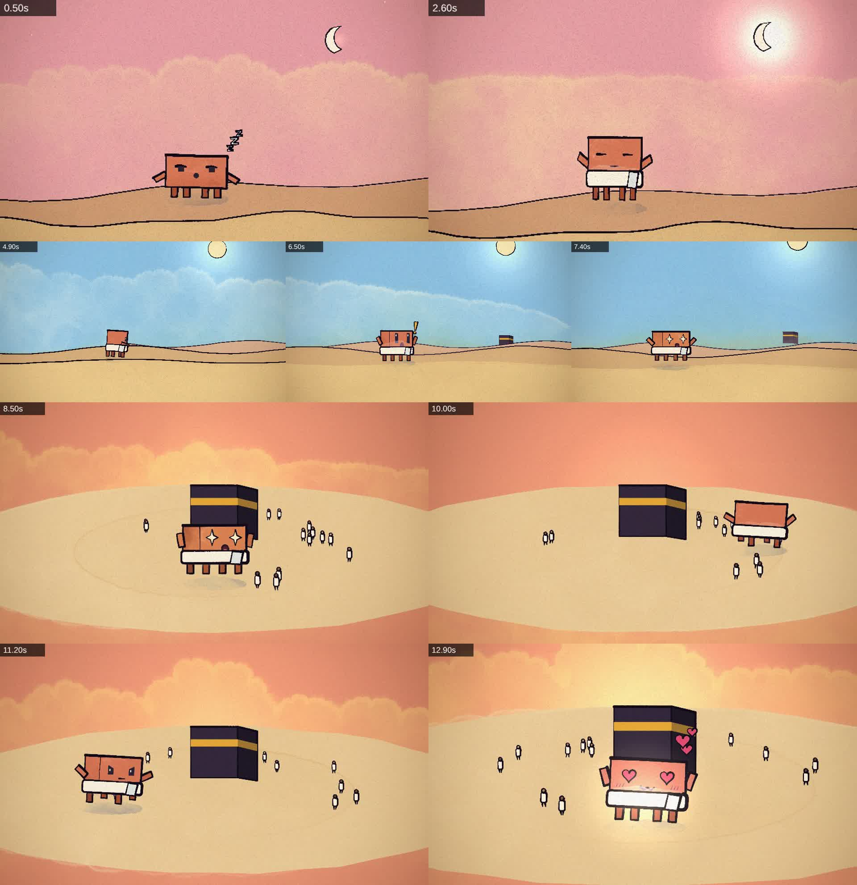

# Clawd goes on Hajj

A 14-second hand-painted animation scene for the
[ClaudeAnimationBase](https://github.com/JohnHeibel/ClaudeAnimationBase) kit
(MIT, p5.js + p5.brush), written with the `clawd-animation` skill. No text
appears anywhere in the film.



- `hajj.js`: the scene (three shots: the moon, the road, the circling).
- `STORYBOARD.md`: logline, palette, reads and timing.

## Render it

Written against ClaudeAnimationBase commit `0ac8bf2`.

```bash
git clone https://github.com/JohnHeibel/ClaudeAnimationBase.git
cd ClaudeAnimationBase && git checkout 0ac8bf2b31942376cb6b8c4074715595d512acd2
npm ci --ignore-scripts
cp /path/to/clawd-hajj/hajj.js src/scenes/hajj.js
# src/config.js: const PROJECT = { duration: 14, bpm: 100, offset: 0 };
# studio.html: replace the demo.js script tag with src/scenes/hajj.js
node render.mjs --sheet=0.5,2.6,6.5,10,12.9 --cols=5 --w=480 --out=out/sheet.jpg
node render.mjs --clip --out=out/video.mp4
```

Without a GPU, add `--soft-gl` and `--chrome=<path>`; frames then take 30 to 110
seconds each, so render sheets rather than the whole video.
